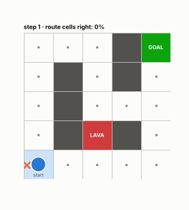
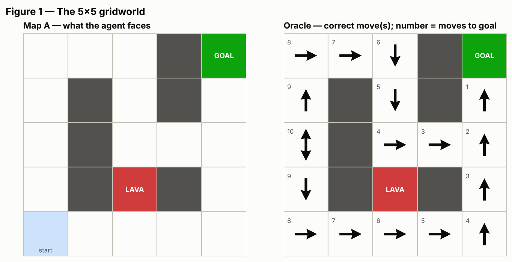
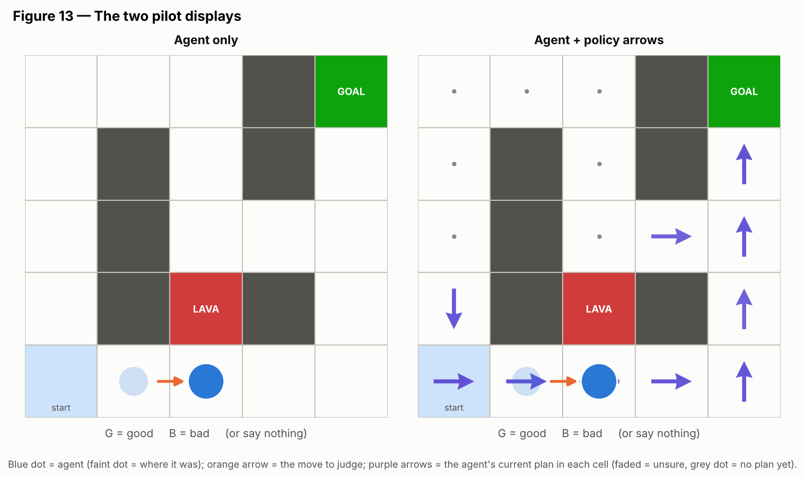
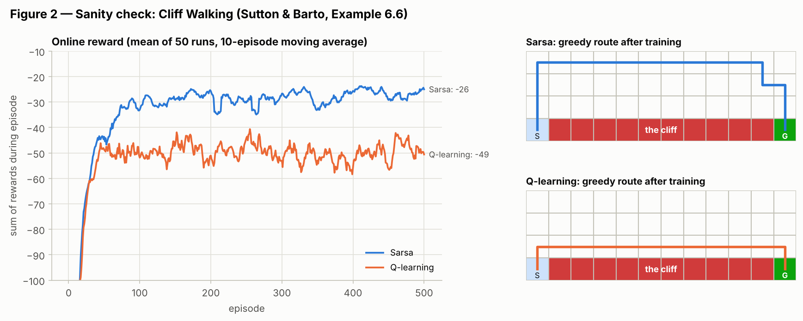
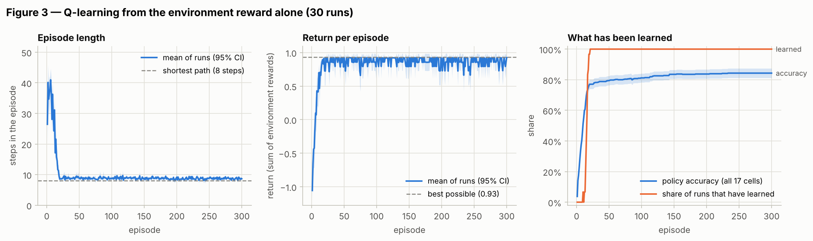
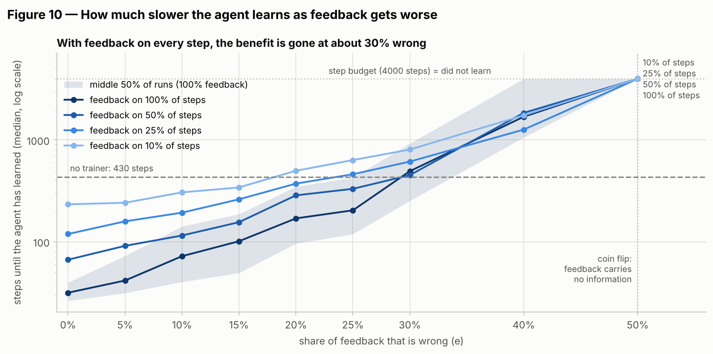
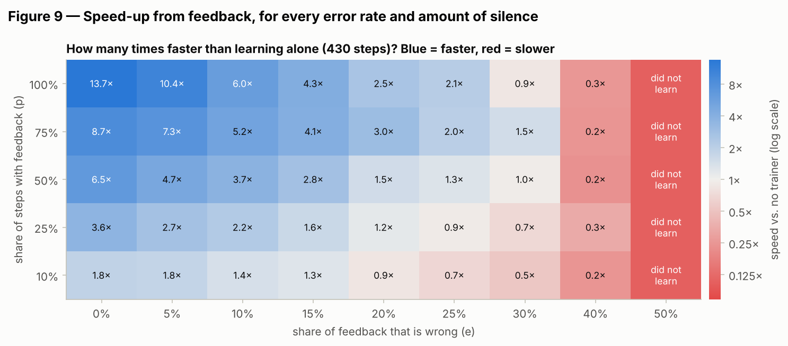
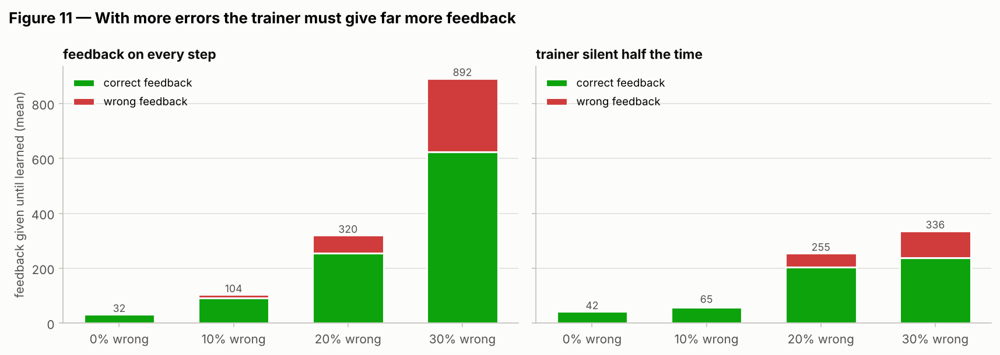
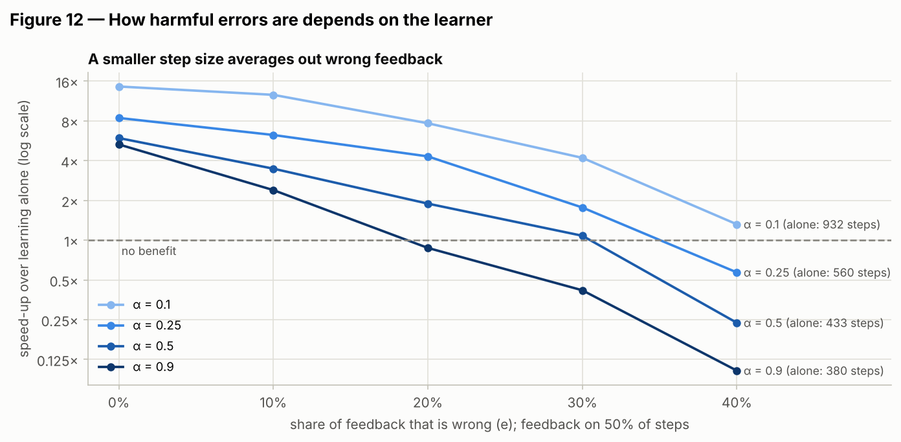
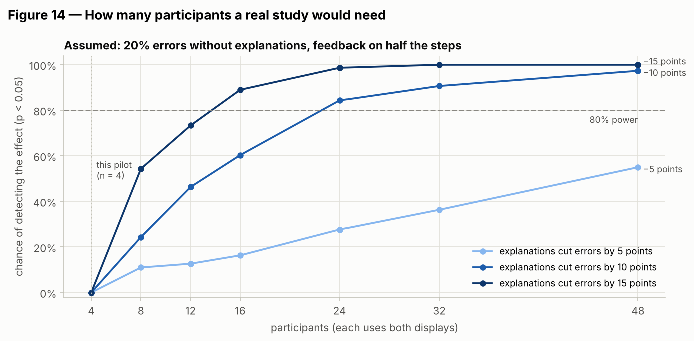

# Does seeing the agent's plan make human feedback more useful?

*A small first test in a 5×5 gridworld: Q-learning (Sutton & Barto, Ch. 6), a simulated trainer whose feedback is sometimes wrong or missing, and a tool for a human pilot.*

[](explanation_feedback_rl.ipynb)
[](https://colab.research.google.com/github/bosu0077/explanations-human-feedback-rl/blob/main/explanation_feedback_rl.ipynb)


<p align="center">
  
  <br><sub>The explanation shown to participants: the agent's current plan (purple arrows) forming while a simulated trainer presses GOOD / BAD.</sub>
</p>

## TL;DR

* **Question.** When a person trains a reinforcement-learning agent by pressing *good* or *bad*, does an explanation of the agent's behaviour — arrows showing what it currently plans to do in every cell — make that person's feedback more useful?
* **What the simulation shows.** For a Q-learner in a 5×5 gridworld, a perfect trainer makes learning **14× faster** than learning from the reward alone (32 vs 430 steps). With **10 %** wrong feedback it is still **6× faster**; at **30 %** wrong the benefit is **gone**. A trainer who is right 90 % of the time gets the agent there **6.9× faster** than one who is right 70 % of the time.
* **Why that matters here.** Feedback *quality* is a strong lever. If seeing the agent's plan makes people even ten points more accurate, the simulation predicts a large change in learning speed. Testing that with people is what the pilot is for.
* **Status of the human pilot.** The app, protocol and pre-specified analysis are ready ([`pilot/`](pilot/)). **No human data has been collected yet**, so this README reports no human results; the notebook only runs the analysis on clearly labelled simulated participants to check the pipeline.

---

## 1. The question and the gap

In interactive RL, a person watches an agent and gives evaluative feedback (good/bad) instead of — or on top of — a reward function (TAMER; Knox & Stone, 2009). Feedback from people is **noisy and sparse**: they misjudge moves, press late, and often say nothing.

Most work makes the **learner** robust to this: *Advise* treats feedback as noisy labels with a consistency parameter (Griffith et al., 2013); strategy-aware learners interpret silence (Loftin et al., 2016); COACH models feedback that depends on the learner's current policy (MacGlashan et al., 2017). Fewer studies change **what the trainer sees**. Those that did found that the agent's display changes teaching: a robot that revealed its uncertainty through gaze received more guidance where it was unsure (Thomaz & Breazeal, 2008), and informative TAMER interfaces made people train longer and give more feedback — but sharing uncertainty could also distract trainers into giving poorer feedback (Li et al., 2013, 2015). Explanations of RL agents, such as policy summaries, are mostly evaluated by how well they help people *understand* agents (e.g. HIGHLIGHTS; Amir & Amir, 2018), not by how they change *teaching*; explanatory interactive learning (Teso & Kersting, 2019) does this for supervised models.

**Open question:** does an explanation of the agent's behaviour improve the *usefulness* of evaluative feedback — not just its amount — and how much does that matter for the learner? This repository is a first, small step: it measures how strongly feedback quality drives learning (simulation), and builds and pre-specifies a pilot that compares feedback with and without an explanation.

## 2. Setup

| | |
|---|---|
| **Environment** | 5×5 deterministic gridworld (below). Rewards: +1 goal, −1 lava (ends the episode), −0.01 per other step; bumping into a wall wastes a step; 50-step episode limit. The shortest route is 8 moves; going up the left column is a 12-move detour. |
| **Agent** | Tabular Q-learning, Sutton & Barto (2018) Eq. 6.8; α = 0.5, γ = 0.95, ε = 0.1, Q₀ = 0. Checked against the book's Cliff Walking example (Example 6.6). |
| **"Learned"** | The greedy policy from the start follows a shortest path. *Policy accuracy* = share of cells whose greedy action is a shortest-path move. |
| **Simulated trainer** | Speaks on a share **p** of steps (otherwise silent); says +1 for a correct move and −1 otherwise, but gives the wrong sign with probability **e** — i.e. consistency C = 1 − e and likelihood L = p in Griffith et al.'s terms. The agent learns from r_env + h. |
| **Human pilot** | Within-subject, 3–4 people, two displays (*agent only* vs. *agent + policy arrows*), counterbalanced order, mirrored map in session 2, keys G = good / B = bad. Measures fixed in advance: key presses until learned, share of correct presses, agent steps until learned. Details: [`pilot/README.md`](pilot/README.md). |

<p align="center"></p>
<p align="center"></p>

## 3. Results

### 3.1 The Q-learner works (Part 1)

It reproduces Sutton & Barto's Cliff Walking result — Q-learning learns the optimal path along the cliff edge but, exploring ε-greedily, earns less online reward than Sarsa, which learns the safer path (last 100 episodes: **−49 vs −26**). On the 5×5 map it first follows a shortest path after a median of **16 episodes (≈ 470 steps)**.

<p align="center"></p>
<p align="center"></p>

More in the notebook: how the policy and values develop (Fig. 4), the learned Q-table (Fig. 5), sensitivity to α and ε (Fig. 6).

### 3.2 Wrong or missing feedback slows learning — a lot (Part 2)

Median steps until learned, 50 runs per condition (full table: [`results/part2_summary.csv`](results/part2_summary.csv)):

| Trainer | every step | silent half the time |
|---|---|---|
| none (reward only) | 430 | 430 |
| 0 % wrong | **32** (14× faster) | 66 |
| 10 % wrong | **72** (6× faster) | 115 |
| 20 % wrong | 170 | 286 |
| 30 % wrong | **494** (no benefit) | 452 |
| 50 % wrong (coin flip) | learned in only 8 % of runs within 4 000 steps | — |

<p align="center"></p>
<p align="center"></p>

* **Errors cost more than silence.** Being silent half the time slows a perfect trainer down about 2×; going from 10 % to 30 % wrong slows the agent down about 7×.
* **More errors means far more feedback is needed** before the agent learns — and much of it is wrong (Fig. 11).
* **The learner matters.** With 30 % wrong feedback (silent half the time) a cautious learner (α = 0.1) still gains **4.2×** over learning alone, versus **1.1×** for α = 0.5 (Fig. 12) — smaller steps average wrong signals out.
* **A side effect relevant to explanations:** a rewarded agent sticks to its route and rarely explores elsewhere, so over the whole map it ends up knowing *fewer* cells than an agent without a trainer (74 % vs 84 % after 1 500 steps; Fig. 7). In the arrow display, people will therefore see some wrong arrows in cells the agent hardly visits — and cannot fix them.

<p align="center"></p>
<p align="center"></p>

### 3.3 Human pilot (Part 3)

**Status: tool and analysis ready; data collection pending (n = 0 so far).** Nothing in this section is a human result yet. The analysis below was written *before* collecting data; once the pilot is run, `python pilot/analyze_pilot.py --update-readme` fills in this block.

<!-- PILOT-RESULTS:START -->
_No pilot data yet. Planned: 3–4 participants × 2 sessions (≈ 15 minutes each). Reported per person and display: key presses until the agent learned, share of presses that were correct, and agent steps until it learned — descriptively, without significance tests._
<!-- PILOT-RESULTS:END -->

### 3.4 How big would a real study need to be? (Part 4)

With 4 people, a paired test **cannot** reach p < 0.05 even if everyone improves (the smallest possible sign-flip p-value is 2/16 = 0.125). Simulating a within-subject study — 20 % errors without explanations (person-to-person spread 7 points), feedback on half the steps, learning times drawn from the Part 2 simulations — gives about **24 participants** for 80 % power if explanations cut errors by 10 points, and about **16** for 15 points. These numbers rest on assumptions that the pilot is meant to replace with measured values.

<p align="center"></p>

## 4. Limitations

* **Pilot only.** 3–4 participants (friends, not naive users) can show the direction and spread of effects and test the procedure; they cannot support a conclusion. At the time of writing the pilot has not been run.
* **One toy task.** A deterministic 5×5 map that people see in full, which makes judging moves easier than in most real tasks.
* **"Correct" is defined by a shortest-path oracle.** A person may reasonably judge a move differently (e.g. a safe detour); the oracle counts that as wrong.
* **One simple learner.** Feedback is used as shaping reward; how harmful errors are depends strongly on the learner (Fig. 12). Learners designed for noisy or silent feedback (Advise, strategy-aware learning, COACH) may change the picture.
* **A simplistic simulated trainer.** Independent errors and random silence; real people taper their feedback, use silence strategically and judge relative to the agent's current behaviour.
* **Order and timing effects.** Counterbalancing and a mirrored map reduce, but do not remove, practice effects; a very late key press is credited to the next move.
* **One kind of explanation.** Greedy-policy arrows with a confidence fade. Other explanations may act differently, and showing uncertainty can also distract (Li et al., 2015).

## 5. Next steps

1. Run the pilot (≈ 15 minutes per person) and report it descriptively.
2. Use its measured error rates, feedback rates and spread to redo the power analysis; pre-register a properly sized within-subject study.
3. Compare plain reward shaping with a learner that models feedback noise (e.g. Advise) under both displays.
4. Test richer explanations (value maps, policy summaries) in a larger domain where the person cannot see everything at once, and let people give feedback on the plan itself, not only on executed moves.

## 6. Data

No external dataset is needed: an RL agent generates its own data by acting, and the human feedback is exactly what the pilot collects. I checked public human-feedback datasets — **Uni-RLHF** (Yuan et al., 2024; ≈ 15 M steps of crowdsourced labels, mostly comparative, for D4RL/Atari/SMARTS tasks) and **Atari-HEAD** (Zhang et al., 2020; human demonstrations with eye-tracking) — but neither contains good/bad feedback given with and without an explanation, so neither can answer this question. They could later help calibrate the simulated trainer's error model.

This repository releases its own data: all simulation results in [`results/`](results/) (CSV) and, once collected, the pilot logs in [`pilot/data/`](pilot/data/) — one row per agent step, with the data dictionary in [`pilot/README.md`](pilot/README.md).

## 7. Reproduce

```bash
git clone https://github.com/bosu0077/explanations-human-feedback-rl.git
cd explanations-human-feedback-rl
pip install -r requirements.txt
jupyter notebook explanation_feedback_rl.ipynb      # runs top to bottom in 1–3 minutes
python -m pytest -q                                  # 29 tests
```

Tested with Python 3.11–3.13 (numpy ≥ 1.23, matplotlib ≥ 3.7, pandas ≥ 1.5). Run the human pilot (needs a normal desktop Python with a window; on Linux `sudo apt install python3-tk`):

```bash
python pilot/pilot_app.py --simulate          # 10-second install check, no window
python pilot/pilot_app.py --participant P1    # practice + 2 sessions, ≈ 15 min per person
python pilot/analyze_pilot.py --update-readme # tables, figures, and this README's pilot block
```

## 8. Repository layout

```
explanation_feedback_rl.ipynb   the full study, executed, with all figures (self-contained)
src/hitl_gridworld.py           all code: gridworld, oracle, Q-learning/Sarsa, simulated trainer,
                                pilot session logic, analysis, power analysis
pilot/pilot_app.py              keyboard pilot app (matplotlib window)
pilot/analyze_pilot.py          pre-specified pilot analysis; updates this README
pilot/README.md                 protocol, consent script, counterbalancing, data dictionary
pilot/data/                     pilot logs (empty until the pilot is run)
figures/  results/              every figure and number in this README
tests/                          pytest suite (environment, agents, trainer, pilot, analysis)
tools/                          builds the notebook from src/ so code exists in one place
```

## 9. References

* Amir, D., & Amir, O. (2018). HIGHLIGHTS: Summarizing agent behavior to people. *AAMAS*, 1168–1176.
* Griffith, S., Subramanian, K., Scholz, J., Isbell, C. L., & Thomaz, A. L. (2013). Policy shaping: Integrating human feedback with reinforcement learning. *NeurIPS*, 2625–2633.
* Knox, W. B., & Stone, P. (2009). Interactively shaping agents via human reinforcement: The TAMER framework. *K-CAP*.
* Knox, W. B., & Stone, P. (2010). Combining manual feedback with subsequent MDP reward signals for reinforcement learning. *AAMAS*.
* Lee, K., Smith, L., Dragan, A., & Abbeel, P. (2021). B-Pref: Benchmarking preference-based reinforcement learning. *NeurIPS Datasets and Benchmarks*.
* Li, G., Hung, H., Whiteson, S., & Knox, W. B. (2013). Using informative behavior to increase engagement in the TAMER framework. *AAMAS*. Extended: Li, Whiteson, Knox & Hung (2015), *Autonomous Agents and Multi-Agent Systems*, doi:10.1007/s10458-015-9308-2.
* Loftin, R., Peng, B., MacGlashan, J., Littman, M. L., Taylor, M. E., Huang, J., & Roberts, D. L. (2016). Learning behaviors via human-delivered discrete feedback: Modeling implicit feedback strategies to speed up learning. *Autonomous Agents and Multi-Agent Systems*, 30(1), 30–59.
* MacGlashan, J., Ho, M. K., Loftin, R., Peng, B., Wang, G., Roberts, D. L., Taylor, M. E., & Littman, M. L. (2017). Interactive learning from policy-dependent human feedback. *ICML*, PMLR 70, 2285–2294.
* Peng, B., MacGlashan, J., Loftin, R., Littman, M. L., Roberts, D. L., & Taylor, M. E. (2016). A need for speed: Adapting agent action speed to improve task learning from non-expert humans. *AAMAS*, 957–965.
* Retzlaff, C. O., Das, S., Wayllace, C., Mousavi, P., Afshari, M., Yang, T., Saranti, A., Angerschmid, A., Taylor, M. E., & Holzinger, A. (2024). Human-in-the-loop reinforcement learning: A survey and position on requirements, challenges, and opportunities. *JAIR*, 79, 359–415.
* Sutton, R. S., & Barto, A. G. (2018). *Reinforcement Learning: An Introduction* (2nd ed.), Ch. 6. MIT Press.
* Teso, S., & Kersting, K. (2019). Explanatory interactive machine learning. *AIES*, 239–245.
* Thomaz, A. L., & Breazeal, C. (2008). Teachable robots: Understanding human teaching behavior to build more effective robot learners. *Artificial Intelligence*, 172(6–7), 716–737.
* Yuan, Y., Hao, J., Ma, Y., Dong, Z., Liang, H., Liu, J., Feng, Z., Zhao, K., & Zheng, Y. (2024). Uni-RLHF: Universal platform and benchmark suite for reinforcement learning with diverse human feedback. *ICLR*.
* Zhang, R., Walshe, C., Liu, Z., Guan, L., Muller, K. S., Whritner, J. A., Zhang, L., Hayhoe, M. M., & Ballard, D. H. (2020). Atari-HEAD: Atari human eye-tracking and demonstration dataset. *AAAI*, 34(04), 6811–6820.

---

**Author:** Pranto Bosu · [github.com/bosu0077](https://github.com/bosu0077) · MIT License
